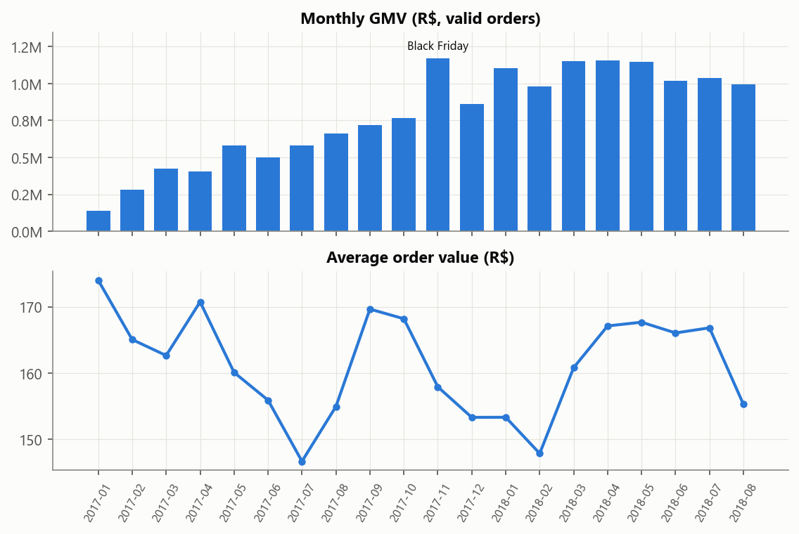
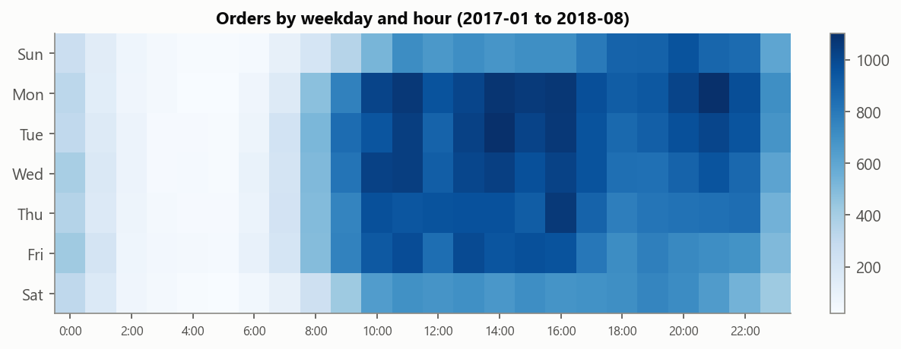
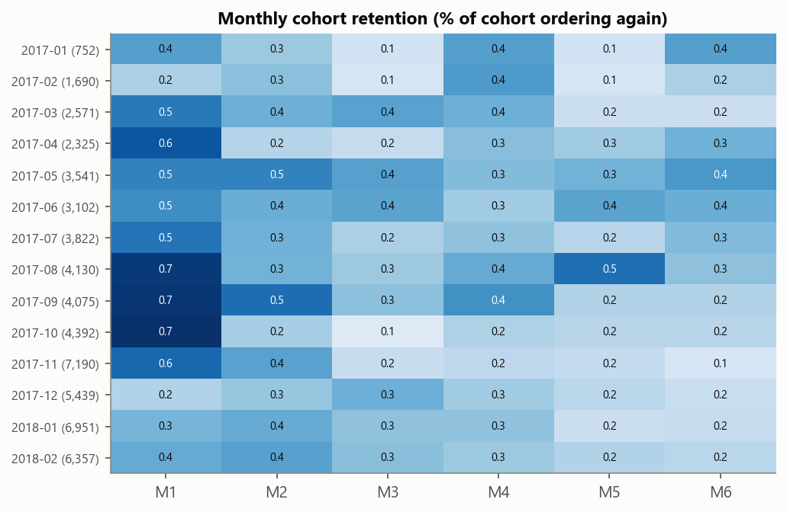
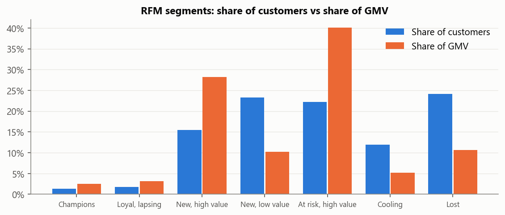
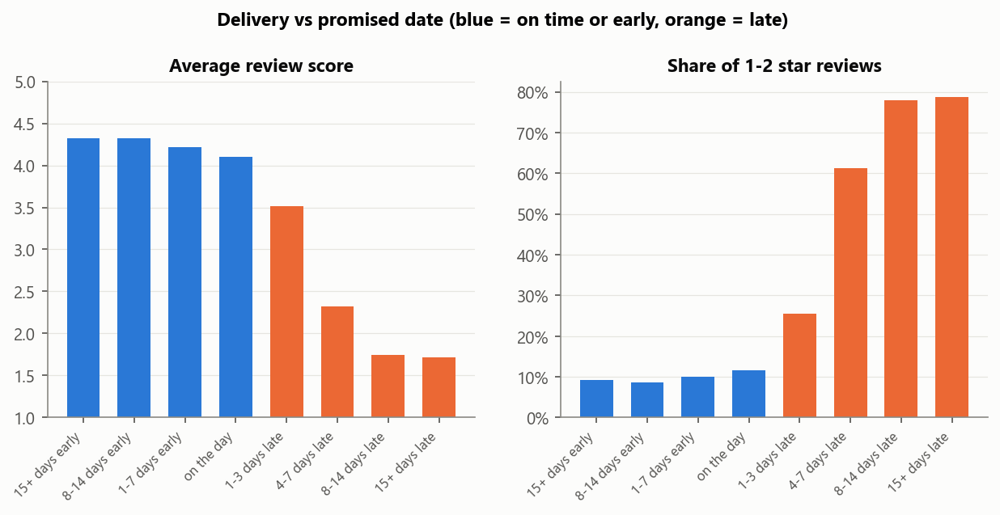
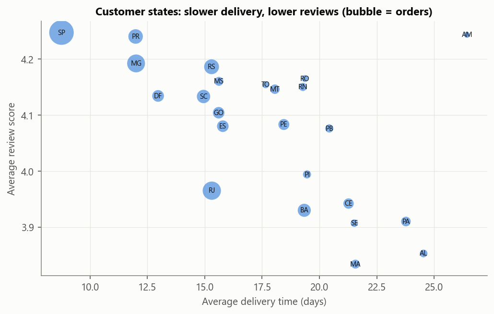
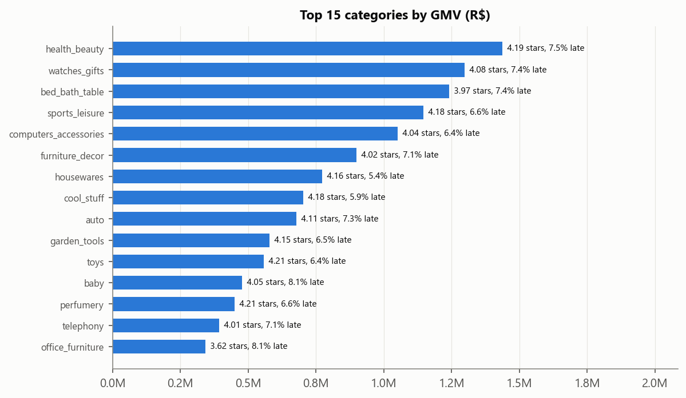
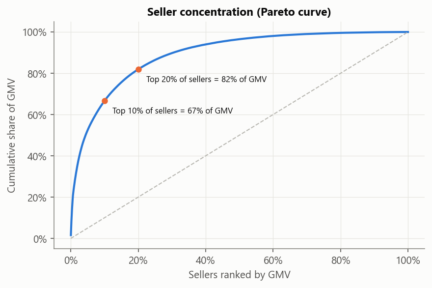
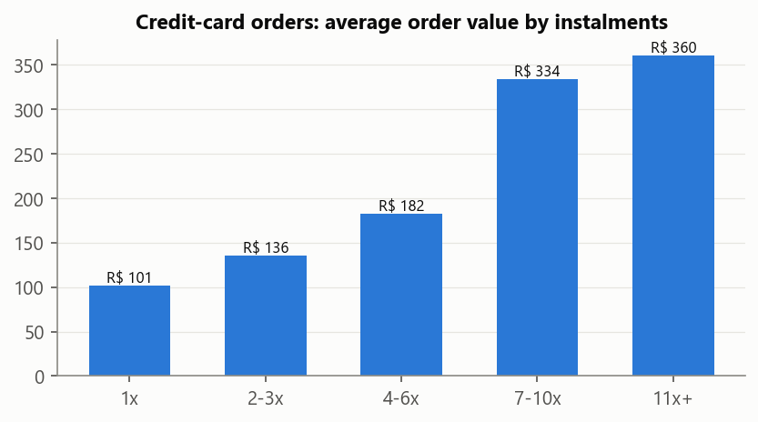

# Olist Brazilian E-commerce Analysis

> Data: Kaggle 'Brazilian E-Commerce Public Dataset by Olist' (real data); source: Kaggle (kagglehub, latest release)
> 99,441 orders from 2016-09-04 to 2018-10-17; 98,207 valid (not canceled/unavailable), 96,470 delivered.
> Trends use 2017-01 to 2018-08 only; months outside that window have too few orders.

## 0. Executive summary

| Area | Key numbers | Interpretation |
|---|---|---|
| Scale | 99,441 orders, 96,096 customers, 3,095 sellers, GMV R$ 15,735,527 | AOV R$ 160; freight is 14.2% of GMV |
| Growth | Jan-Aug 2018 vs Jan-Aug 2017: orders +137%, GMV +140% | Strong growth; peak day 2017-11-24 with 1,166 orders vs a daily average of 163 |
| Retention | Only 3.0% of customers order twice, and only 2.2% on a different day; repeat customers bring 5.7% of GMV | Growth is almost entirely new-customer acquisition |
| Delivery | 6.8% of orders arrive late; on average orders arrive 11.2 days before the promised date | Promised dates are heavily padded, yet late orders still happen |
| Satisfaction | Avg review 4.29 on time vs 2.27 late; 1-2 star share 9.2% vs 62.4% | A late order is 16.3x as likely (odds) to get a 1-2 star review |
| Sellers | Top 10% of sellers = 67% of GMV; 54 sellers (30+ orders) are late at 2x+ the platform rate | They handle 4.6% of delivered orders but cause 11.2% of late orders |
| Payment | credit card is used for 77% of orders | Orders paid in 11+ instalments are 3.6x the value of 1x orders |

## 1. Sales and seasonality

- GMV grew from R$ 136,943 in 2017-01 to R$ 996,974 in 2018-08; AOV stayed roughly flat between R$ 147 and R$ 174, so growth came from **more orders, not bigger baskets**.
- Black Friday (2017-11-24) produced 7.2x a normal day's orders.

- Orders peak around 16:00; weekdays average 1.34x the weekend volume, so campaigns and customer-service staffing should lean to weekday daytime.

## 2. Customers: almost nobody comes back
- 94,990 customers, 2,888 with 2+ orders (repeat rate 3.0%).
- 896 of them placed the second order on the **same day** as the first, which is usually one basket split into two orders, not a return visit. Counting only orders on different days, the true repeat rate is **2.2%** (2,065 customers). Of those genuine returns, 54% came back within 90 days, so the first three months are the window to act in.
- Customers whose first order got 4-5 stars vs 1-2 stars come back at 3.06% vs 2.81% (p = 0.13); the difference is **not** statistically significant, so a bad first review is not what keeps customers away; almost nobody comes back either way.

**Recommendation 1: build a second-purchase programme.** Every +1 percentage point of true repeat rate is about 949 extra orders, or **R$ 152,202 GMV** at the current AOV. Test a post-delivery coupon for a second order within 90 days (A/B test, primary metric: 90-day repeat rate).

## 3. RFM segmentation (R, F and M all available)

| Segment | Customers | Share | GMV share | Avg recency (days) | Avg orders | Avg spend | Action |
|---|---|---|---|---|---|---|---|
| Champions | 1,240 | 1.3% | 2.5% | 94 | 2.16 | R$ 321 | VIP treatment, early access, referral programme |
| Loyal, lapsing | 1,648 | 1.7% | 3.1% | 327 | 2.08 | R$ 298 | Personal win-back offer before they go cold |
| New, high value | 14,650 | 15.4% | 28.2% | 98 | 1.00 | R$ 303 | Second-purchase coupon in the first 90 days; cross-sell |
| New, low value | 22,106 | 23.3% | 10.3% | 95 | 1.00 | R$ 73 | Low-cost onboarding emails; category recommendations |
| At risk, high value | 21,050 | 22.2% | 40.1% | 342 | 1.00 | R$ 299 | Highest-value win-back target: targeted discount |
| Cooling | 11,337 | 11.9% | 5.2% | 226 | 1.00 | R$ 72 | Reminder campaigns, low spend |
| Lost | 22,959 | 24.2% | 10.6% | 402 | 1.00 | R$ 73 | Exclude from paid retargeting |

R and M are NTILE(5) scores; F is "1 order" vs "2+ orders" because 97% of customers ordered only once. "At risk, high value" customers alone hold 40.1% of GMV.

## 4. Delivery and satisfaction

- Review score: on-time > late (Mann-Whitney U): 4.29 vs 2.27, p = 0, rank-biserial r = 0.64.
- Low review (1-2 stars) rate: late vs on-time (chi-square): 62.4% vs 9.2%, p = 0, odds ratio 16.3 (95% CI 15.4-17.2).
- Orders arrive 11.2 days early on average (actual 12.6 days vs promised 23.7). Sellers take 3.2 days on average to hand parcels to the carrier.

- Worst late rates: AL 21.4%, MA 17.4%, SE 15.2%, PI 13.9%, CE 13.8%.
- States: late rate vs average review (Spearman): rho = -0.91, p = 7.5e-10.
- Remote states pay more freight: MA 21%, RO 20%, AM 20%, SE 20%, PI 19% of the bill is freight.

**Recommendation 2: cut late deliveries.** There are about 6,531 late orders. Halving the late rate would avoid about **1,735 one- and two-star reviews** (late vs on-time low-review gap of 53.1%). Start with the states above and with the sellers below.

## 5. Categories and sellers

**Recommendation 3: manage the late-shipping sellers.** 54 of 634 sellers with 30+ orders are late at least twice as often as the platform (6.8%). They handle 4,395 orders (4.6% of delivered orders) but account for 11.2% of all late orders. List in `tables/seller_risk.csv`; actions: handover-time SLA, ranking penalty, carrier review.

## 6. Payments

- credit card: 77.0% of orders, AOV R$ 166
- boleto: 19.9% of orders, AOV R$ 145
- voucher: 1.6% of orders, AOV R$ 105
- debit card: 1.5% of orders, AOV R$ 140
- unknown: 0.1% of orders, AOV R$ 168

## 7. Limitations and next steps
1. Observational data: the recommendations are sized from correlations; each needs an A/B test or a pilot.
2. The review table has 99,224 rows. Reviews are optional and some orders have several; scores are averaged per order.
3. GMV uses item price + freight; payment value can differ because of vouchers and instalment interest.
4. Next: a delivery-delay model (seller handover time, distance, category, month) to predict late orders before they ship, and a churn/repeat model for the second-purchase programme.
